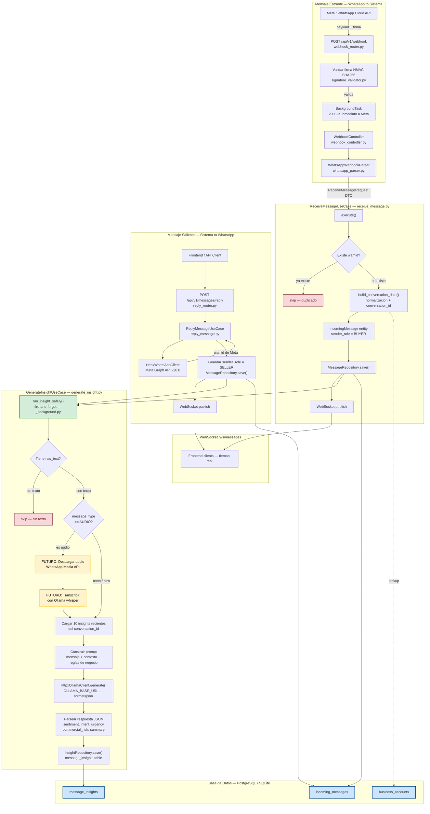

# Diagrama de Procesos — Mensajería + Insights

---

## Leyenda de colores

| Color | Significado |
|-------|-------------|
| Amarillo | **Funcionalidad futura** — descarga y transcripción de audio con Ollama |
| Verde | Trigger de insight (fire-and-forget) |
| Azul | Tablas de base de datos |
| Rojo | Paths de salida temprana (skip) |

---

## Expansion de Audio — Plan

Cuando ingresa un mensaje de tipo `AUDIO`:

1. **Detectar** `message_type == MessageType.AUDIO` en `GenerateInsightUseCase`
2. **Descargar** el archivo desde Meta con `whatsapp_client.download_media(media_id)`
3. **Transcribir** usando Ollama con `ollama_client.transcribe(audio_bytes, model)`
4. **Continuar** el flujo normal con el texto transcripto

### Archivos a modificar

| Archivo | Cambio |
|---------|--------|
| `domain/services/ollama_client.py` | Agregar `transcribe(audio_bytes, model)` |
| `infrastructure/http/ollama_client.py` | Implementar llamada HTTP de transcripcion |
| `application/use_cases/generate_insight.py` | Branch `if message_type == AUDIO` antes de `CTX_LOAD` |
| `infrastructure/http/whatsapp_client.py` | Agregar `download_media(media_id)` |
| `domain/services/whatsapp_client.py` | Interfaz `download_media` |
